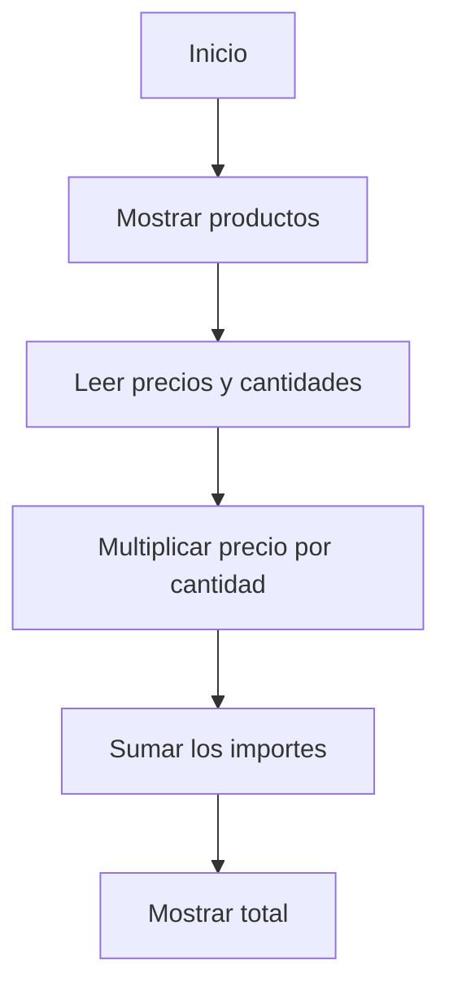

# Tienda TECSUP


Aplicación web sencilla que muestra productos de la tienda TECSUP.
Permite visualizar precios, cantidades y calcular automáticamente
el importe total de los productos seleccionados.

## Tabla de contenidos

- [Descripción](#descripcion)
- [Tecnologías](#tecnologias)
- [Instalación](#instalacion)
- [Uso](#uso)
- [Funciones](#funciones)
- [Estado del proyecto](#estado-del-proyecto)
- [Diagrama de funcionamiento](#diagrama-de-funcionamiento)
- [Contribución](#contribucion)
- [Licencia](#licencia)

## Descripción

El proyecto presenta una tienda básica desarrollada con tecnologías web.
Su objetivo es mostrar productos y calcular el total según sus precios y cantidades.

## Tecnologías

- HTML5
- CSS3
- JavaScript

## Instalación

Clonar el repositorio:

```bash
git clone https://github.com/chrismontes-lab/tienda-tecsup.git
cd tienda-tecsup
```

## Uso

Abrir el archivo `index.html` en un navegador web.

Ejemplo de cálculo:

```javascript
let precio = 25;
let cantidad = 2;
let total = precio * cantidad;

console.log(total);
```

## Funciones

| Funcionalidad | Descripción | Estado |
|:---|:---|:---:|
| Mostrar productos | Presenta los productos de la tienda | Listo |
| Mostrar precios | Indica el precio de cada producto | Listo |
| Cantidades | Muestra las unidades disponibles | Listo |
| Calcular total | Multiplica precio por cantidad | Listo |
| Estilos CSS | Da formato a la página | Listo |

## Estado del proyecto

- [x] Crear estructura HTML
- [x] Aplicar estilos CSS
- [x] Mostrar productos y cantidades
- [x] Calcular el total correctamente
- [ ] Incorporar nuevas funcionalidades

## Diagrama de funcionamiento



## Contribución

Consulta el archivo [CONTRIBUTING.md](CONTRIBUTING.md) para conocer cómo colaborar con este proyecto.

## Licencia

Este proyecto todavía no tiene una licencia de uso definida.
